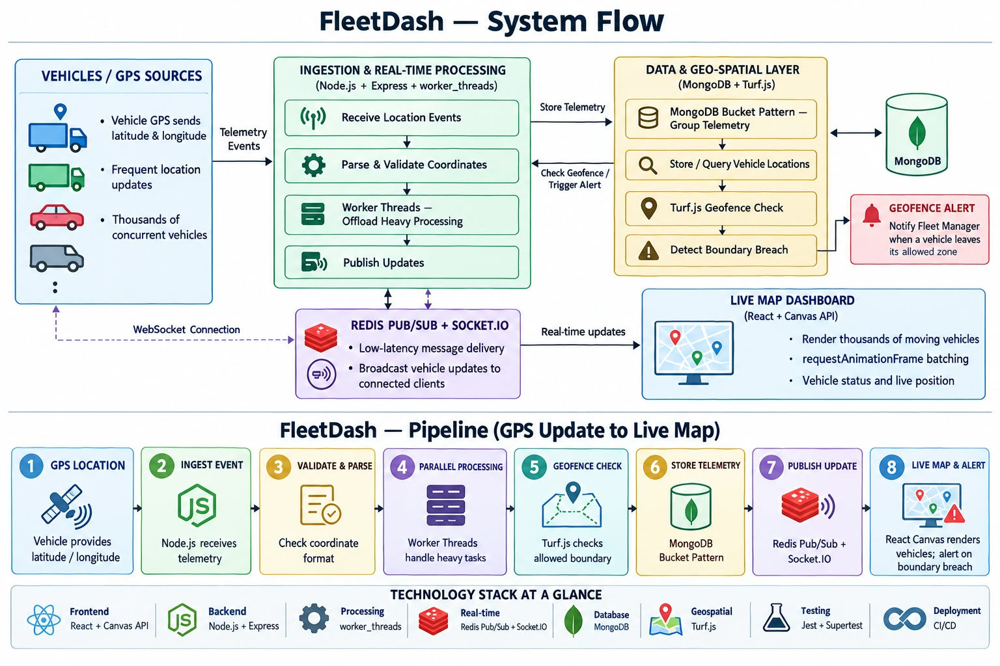

# FleetDash


**High-throughput, event-driven fleet telemetry dashboard.** Thousands of vehicles send GPS readings; the backend
stores them efficiently, shows them live on a map and raises an alert the moment a vehicle leaves a geofenced zone,
without dropping a single data point. Built as an internship project for Infotact Solutions.



## Highlights

- **Fast ingestion:** 2,000 requests per second sustained for 30 s with no lost data and nothing dropped (95th percentile 161 to 210 ms, three clean runs in a row)
- **Efficient storage:** MongoDB hourly buckets (one vehicle per clock hour, safety cap 1,000 readings), queries under 3 ms
- **Live updates:** Redis Pub/Sub and Socket.io deliver the newest position of every vehicle as one binary message every 100 ms
- **Geofence alerts:** Turf.js detects enter and exit events and pushes them live
- **Non-blocking analytics:** trip summary and safety score computed in worker threads
- **Tested:** 294 automated tests (about 91 percent coverage), run on every push by GitHub Actions, also against a real Redis Cluster
- **One-command deployment:** Docker Compose with MongoDB, Redis and the backend, plus an optional real Redis Cluster (3 primaries and 3 replicas)

## Tech stack

| Area | Technology |
|---|---|
| Backend | Node.js, Express, `worker_threads` |
| Database | MongoDB (Bucket Pattern), Mongoose |
| Real-time | Redis Pub/Sub, Socket.io, binary payloads |
| Geospatial | Turf.js |
| Frontend | React, TypeScript, Canvas API |
| Testing | Jest, Supertest, k6 |
| Deployment | Docker, GitHub Actions |

## Quick start

### With Docker (needs Docker Desktop running)

```bash
docker compose up -d --build
docker compose ps                                          # all three services should be healthy
curl http://localhost:5000/api/health
docker compose exec backend node scripts/seed.js --force  # optional: sample vehicles and geofences
docker compose down                                        # stop (add -v to delete the data)
```

The backend listens on port 5000; MongoDB and Redis are exposed on 27018 and 6380 so they do not clash with local installs.

### Redis Cluster (optional)

A real Redis Cluster (3 primaries and 3 replicas, started in Docker) can be used instead of the single Redis:

```bash
docker compose --profile cluster up -d redis-cluster-init   # start the 6 nodes and create the cluster
docker compose exec redis-node-1 redis-cli cluster info     # must show cluster_state:ok
docker compose --profile cluster down -v                    # stop it and delete its data
```

Then start the backend with `REDIS_MODE=cluster` (Windows: `set REDIS_MODE=cluster`). The default is `REDIS_MODE=single`.
See `Backend/README.md` and `docs/architecture.md`.

### Without Docker

You need Node.js 22 or newer, MongoDB and Redis running locally.

```bash
cd Backend
npm install
copy .env.example .env       # Mac and Linux: cp .env.example .env
npm run dev
node scripts/simulator.js    # optional: 20 fake trucks driving around Kolkata
```

### Frontend

See [`Frontend/README.md`](Frontend/README.md).

## Tests

```bash
cd Backend
npm test                  # all tests (needs MongoDB and Redis running)
npm run test:coverage     # with a coverage table
```

## Documentation

| Document | Content |
|---|---|
| [`docs/architecture.md`](docs/architecture.md) | Design, data flow, storage, real-time layer, geofencing, design decisions |
| [`docs/api.md`](docs/api.md) | REST API, Socket.io events and the binary message layout |
| [`docs/weekly-progress.md`](docs/weekly-progress.md) | Weekly log and review checklists |
| [`Backend/README.md`](Backend/README.md) | Backend setup, configuration and scripts |
| [`Backend/loadtests/README.md`](Backend/loadtests/README.md) | Load test results and how to repeat them |

## Repository layout

```
FleetDash/
  Backend/              Node.js API, workers, real-time server, tests, load tests
  Frontend/             React + TypeScript dashboard
  docs/                 architecture, API reference, progress log, diagrams
  docker-compose.yml    MongoDB + Redis + backend (+ optional Redis Cluster)
  .github/workflows/    CI pipeline
```