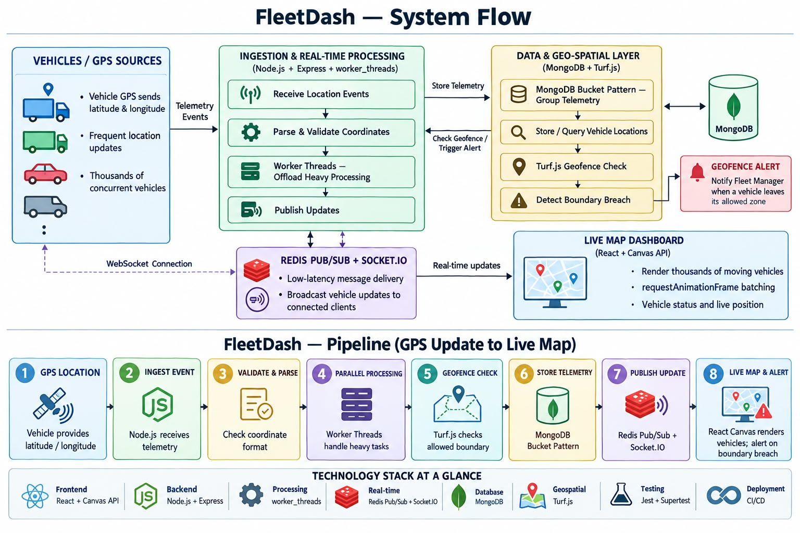

# FleetDash Architecture

FleetDash is an event-driven fleet telemetry system. Vehicles send GPS readings, the backend stores them
efficiently, pushes live positions and geofence alerts to dashboards, and runs heavy analytics without
blocking the server.



## Components

| Component | Technology | Job |
|---|---|---|
| Ingestion API | Node.js, Express | Receives and validates readings |
| Parse and analytics workers | `worker_threads` | Heavy work off the main thread |
| Database | MongoDB, Bucket Pattern | Stores readings in groups of up to 100 |
| Message broker | Redis Pub/Sub | Separates ingestion from client notification |
| Real-time server | Socket.io | Sends live positions and alerts to dashboards |
| Geofence engine | Turf.js | Detects when vehicles enter or leave zones |
| Dashboard | React, Canvas API | Live map (frontend team, see `Frontend/README.md`) |
| Tests | Jest, Supertest | 206 tests, about 88 percent coverage |
| CI and deployment | GitHub Actions, Docker | Automatic checks, one-command stack |

## Data flow

```
 vehicle GPS ──HTTP──► Express ──► validation ──► group commit ──► MongoDB (buckets)
                                                       │
                                                       ├──► Turf.js geofence check ──► alert saved in MongoDB
                                                       │                            └──► Redis "fleet:alerts"
                                                       └──► Redis "fleet:updates"
                                                                │
                              Socket.io server (subscribes) ◄───┘
                                    │  every 100 ms: newest position per vehicle, ONE binary message
                                    ▼
                               dashboards (Canvas map)

 analytics API ──► worker_threads pool ──► trip summary, geofence check
```

## 1. Ingestion

1. **Validation middleware** rejects bad input with a 400 before anything else runs. Vehicle IDs are
   1 to 16 characters (the binary format stores them in 16 bytes), coordinates must be valid, and one batch
   holds at most 5,000 readings.
2. **Group commit.** Readings for the same vehicle that arrive within about 10 ms are written to MongoDB
   together. Only one write per vehicle runs at a time, which prevents duplicate buckets. Every request is
   answered only after its reading is stored, so an accepted reading is never lost.
3. **Large batches** (200 or more readings) are validated and sorted by a small worker pool, off the main thread.
4. **After storing**, the newest position is published to Redis and every reading is checked against the
   geofences, oldest first. This is the same for `/ingest` and `/ingest-batch`.

## 2. Storage: the Bucket Pattern

One document per GPS reading would create millions of small documents. Readings are grouped into
**buckets of up to 100** (`BUCKET_MAX_SIZE`).

```json
{
  "vehicleId": "TRUCK-01",
  "bucketStartTime": "2026-01-01T12:00:00.000Z",
  "bucketEndTime": "2026-01-01T12:01:39.000Z",
  "count": 100,
  "readings": [
    { "timestamp": "2026-01-01T12:00:00.000Z", "location": { "type": "Point", "coordinates": [88.36, 22.57] },
      "speed": 40, "heading": 90, "fuelLevel": 82, "engineTemp": 88, "ignition": true }
  ],
  "summary": { "minSpeed": 0, "maxSpeed": 72, "sumSpeed": 4010, "avgSpeed": 40.1,
               "minFuelLevel": 81, "maxFuelLevel": 83, "maxEngineTemp": 95 }
}
```

- The summary is kept up to date with atomic `$push`, `$inc`, `$min` and `$max` operations, so statistics need no scan of the readings.
- **One compound index** serves both common queries ("find the open bucket" and "latest buckets of a vehicle"):

  `{ vehicleId: 1, bucketStartTime: -1, count: 1 }`

- Measured: about 1 ms per query (95th percentile 1.5 ms), 1 index key and 1 document examined.

## 3. Worker threads

A pool of `worker_threads` runs the analytics maths (trip summary, geofence check, distance) and a second,
smaller pool validates large batches. Tasks wait in a first-in-first-out queue, results come back by task ID,
and a worker that crashes is replaced automatically.

## 4. Real-time delivery

- The ingestion code publishes to the Redis channel **`fleet:updates`**; geofence alerts go to **`fleet:alerts`**.
- Every server instance subscribes to both channels itself, so several instances can run side by side.
- The Socket.io server keeps the **newest position of each vehicle** for 100 ms (`BROADCAST_INTERVAL_MS`),
  then sends all of them to every client as **one binary message** (`vehicles:binary`). If nobody is connected, the updates are dropped.
- Alerts are rare, so each one is sent immediately as JSON (`geofence:alert`).

Binary format (little-endian):

| Part | Size | Content |
|---|---|---|
| Header | 8 bytes | version (uint16, = 1), reserved (uint16), vehicle count (uint32) |
| Record, repeated | 56 bytes | vehicleId (16 ASCII bytes, zero padded), longitude (float64), latitude (float64), timestamp in ms (float64), speed (float32), heading (float32), fuelLevel (float32), ignition (uint32, 0 or 1) |

Example: 1,000 vehicles = 8 + 1,000 x 56 = 56,008 bytes in one message.

## 5. Geofencing and alerts

- Active geofences are kept in memory and reloaded every 5 seconds.
- A cheap **bounding-box test** runs first; only if it passes, the exact Turf.js point-in-polygon test runs.
- The service remembers whether each vehicle was inside or outside each geofence and creates an
  **`exit` or `enter` alert only when that changes**. The first position of a vehicle never creates an alert.
- A geofence with an empty `vehicleIds` list applies to every vehicle.
- Readings are checked **oldest first**, and a reading older than one already checked for that vehicle is skipped, so late or
  backfilled data cannot turn the remembered state back.
- Alerts are stored in MongoDB (with an acknowledge flag) and pushed live over Socket.io.

## 6. Analytics

`/api/analytics/trip-summary/:vehicleId` computes distance (haversine), duration, average and top speed, speeding
count, harsh braking count, idle time and a **safety score** (100 minus 2 per speeding reading and 5 per harsh braking
event, never below 10). Position jumps of 100 km or more between two readings are ignored as GPS errors.

## 7. Deployment

- `docker-compose.yml` starts MongoDB 7, Redis 7 and the backend, each with a health check; the backend waits until both databases are healthy.
- `Backend/Dockerfile`: Node 22 alpine, production dependencies only, runs as a non-root user, health check on `/api/health`.
- `.github/workflows/ci.yml` runs on every push: (1) all backend tests with real MongoDB and Redis, (2) builds the Docker image, starts the stack and checks the health route and one ingest.

## 8. Design decisions

| Decision | Reason |
|---|---|
| Bucket Pattern instead of one document per reading | Far fewer documents, smaller index, ready-made statistics |
| Group commit, answer after the write | High write throughput with no accepted reading lost |
| Redis Pub/Sub between ingestion and Socket.io | Ingestion does not need to know about clients; easy to run more instances |
| One binary message per 100 ms | Replaces thousands of small JSON messages; the browser can decode it quickly |
| Worker threads for parsing and analytics | The Express event loop stays free for requests |
| Bounding box before Turf.js | Most readings are rejected cheaply |

## 9. Known limits

- Redis runs as a single instance (also in Docker). The design allows more server instances, but Redis itself is not clustered.
- The inside/outside state of each vehicle is kept in memory, so after a server restart the first position of each vehicle is treated as new (no alert).
- Alerts and the live map assume reasonably correct device clocks; a reading older than one already checked for the same vehicle is not used for geofence state.